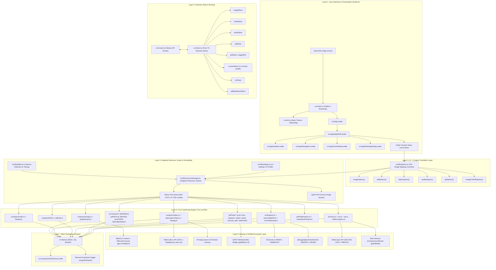
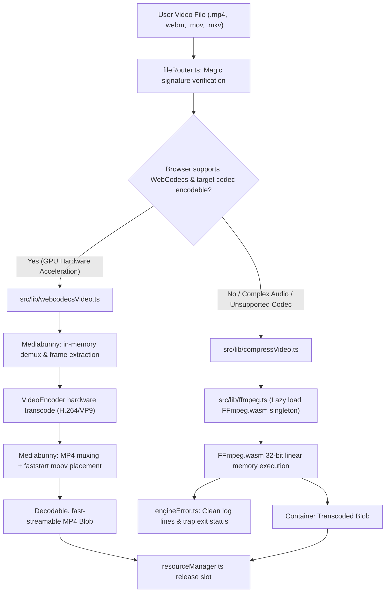
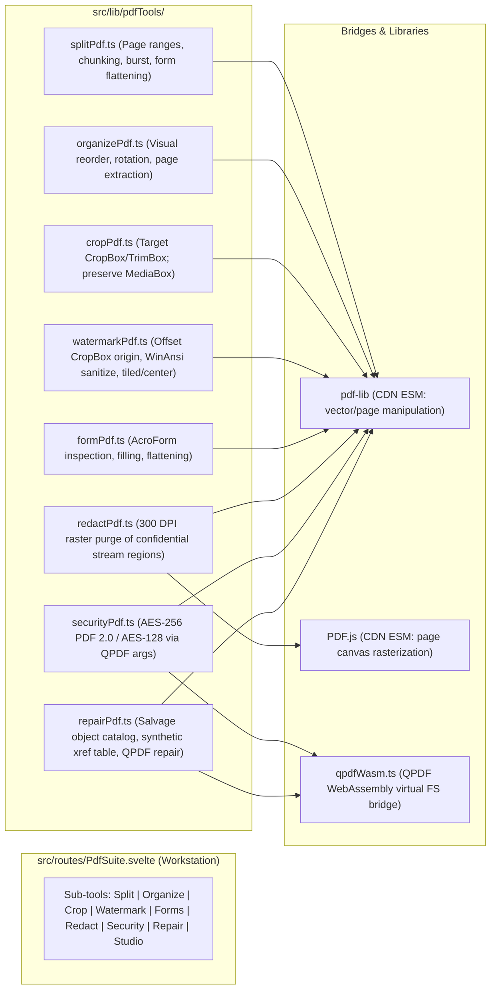

# CompressZ — AI Agent Operating Roadmap & Project Architecture Graph

> **Universal Contributor & AI Agent Playbook**  
> *Targeted for Autonomous Coding Agents, LLMs, and System Engineers*  
> *Last Updated: November 2026 | Engine Version: 1.15.0+*

---

## 1. Executive Summary & Core Identity

**CompressZ** is a client-side, zero-backend, zero-telemetry web workstation for file compression, format conversion, PDF manipulation, and local OCR. Everything executes 100% on the user's local device within the browser sandbox using WebAssembly (WASM), WebCodecs, WebGL2, OffscreenCanvas, Web Streams, and WebCrypto.

### The Immutable Non-Negotiables
1. **Zero External Data Upload**: No bytes, file names, or metadata may ever leave the client browser.
2. **Zero Inlined Heavy Dependencies in `package.json`**: Heavy runtimes (FFmpeg, PDF.js, pdf-lib, Tesseract, QPDF, PaddleOCR, LibreOffice) are loaded dynamically on demand from CDNs with local Cache API persistence.
3. **Canonical npm Environment**: `package.json` and `package-lock.json` are canonical. No Deno references are allowed inside `package.json` scripts or dependencies.
4. **Cloudflare Pages Asset Ceiling**: Strict 24 MiB file ceiling for built assets in `dist/assets` (enforced by `scripts/strip-oversized-assets.mjs`).
5. **No Slop / Pure Svelte 5**: Svelte 5 runes (`$state`, `$derived`, `$props`, `$effect`). React, `@types/react`, and `animejs` are strictly forbidden. Zero `transition: all` in CSS.

---

## 2. System Architecture Graph (Graphified)

### 2.1 Macro Architecture & Layer Dependency Graph



---

### 2.2 Subsystem Interaction Graphs

#### A. Image Processing & SSIM Quality Guard Pipeline
```mermaid
sequenceDiagram
    autonumber
    actor User
    participant Route as src/routes/Images.svelte
    participant Opt as src/lib/options.ts
    participant Guard as src/lib/resourceManager.ts
    participant Core as src/lib/compressImage.ts
    participant Decode as src/lib/imageDecode.ts
    participant GPU as src/lib/gpu.ts & webgl.ts
    participant SSIM as src/lib/qualityGuard.ts

    User->>Route: Drops images / selects format (WebP 82%)
    Route->>Opt: imageOptions(state)
    Opt-->>Route: CompressOptions ({ format, quality: 0.82, maxWidth })
    Route->>Guard: acquireResourceSlot({ kind: 'image', bytes, pixels })
    Guard-->>Route: Slot admitted
    Route->>Core: compressImage(file, options)
    Core->>Decode: decodeImage(file) (Native decode -> lazy heic2any fallback)
    Decode-->>Core: HTMLImageElement / ImageBitmap
    Core->>SSIM: planOutputSize(srcW, srcH, maxW, maxH) [Ceiling only, NEVER upscale]
    Core->>GPU: resizeViaWebGL(bitmap, targetW, targetH) [or OffscreenCanvas 2D]
    GPU-->>Core: Canvas / Blob
    Core->>SSIM: measureEncoded(origSample, encodedBlob) [<=96x96 Luma SSIM]
    alt SSIM < 0.90 (SSIM_FLOOR)
        Core->>Core: Retry once at higher quality (+0.08)
    end
    Core-->>Route: Compressed Blob + SSIM diagnostic note
    Route->>Guard: release()
```

#### B. Video Processing: WebCodecs Fast Path vs. FFmpeg Software Fallback


#### C. PDF Suite & Studio Architecture


---

## 3. Comprehensive File Categorization & Grouping

| Category | Path | Primary Purpose | Key Invariants & Dependencies |
| :--- | :--- | :--- | :--- |
| **Host & Bootstrap** | `index.html`<br>`src/main.ts`<br>`src/init.ts`<br>`src/vite-env.d.ts` | Mount point, Svelte 5 initialization, early theme bootstrap (prevents dark flash), watchdog recovery timer (10s splash fail-safe). | Zero npm styling bloat. Early DOM execution before Svelte mounts. |
| **App Shell** | `src/app/AppShell.svelte`<br>`src/app/Header.svelte`<br>`src/app/Navigation.svelte`<br>`src/app/SettingsDialog.svelte`<br>`src/app/ToolsDialog.svelte` | Core layout shell, sticky header, responsive navigation with scroll-edge mask, accessible dialogs with focus trapping. | Svelte 5 runes. Touch targets $\ge 44\text{px}$. No `transition: all`. |
| **UI Components** | `src/components/FileCard.svelte`<br>`src/components/FileDropzone.svelte`<br>`src/components/FileQueue.svelte`<br>`src/components/MacIcon.svelte`<br>`src/components/ToolsMegaMenu.svelte`<br>`src/components/UniversalUpload.svelte`<br>`src/components/PdfCanvasEditor.svelte`<br>`src/components/SignaturePad.svelte`<br>`src/components/ActionPalette.svelte`<br>`src/components/PageGrid.svelte`<br>`src/components/ProgressStatus.svelte`<br>`src/components/ToolCard.svelte`<br>`src/components/ToolGrid.svelte` | Atomic and molecular UI components. macOS-style vector icons, drag-and-drop file ingestion, PDF page grid, interactive canvas redaction editor, rectangular interactive tool cards and grids. | Strict accessibility (`aria-*`, `role="button"`, `role="list"`). Spring animations via native Web Animations API (`motion.ts`). Zero TSX. |
| **Routed Views** | `src/routes/Home.svelte`<br>`src/routes/Images.svelte`<br>`src/routes/Pdf.svelte`<br>`src/routes/PdfSuite.svelte`<br>`src/routes/Video.svelte`<br>`src/routes/Audio.svelte`<br>`src/routes/Gif.svelte`<br>`src/routes/Ocr.svelte`<br>`src/routes/Convert.svelte`<br>`src/routes/PdfMarkdown.svelte`<br>`src/routes/ImagesToPdf.svelte`<br>`src/routes/MergePdf.svelte`<br>`src/routes/About.svelte`<br>`src/routes/Docs.svelte`<br>`src/routes/Privacy.svelte`<br>`src/routes/Settings.svelte` | Domain-specific tool views. State persistence via stores and local storage profiles. | **Never map options by hand in routes.** Must call `src/lib/options.ts`. Dynamic effect reactivity on route changes. |
| **Option Bridge** | `src/lib/options.ts` | The single translation contract between human UI percentage/preset states and engine mathematical parameters. | Pure TypeScript, zero external dependencies. Verified by `tests/options.test.ts`. |
| **Resource Scheduling** | `src/lib/resourceManager.ts`<br>`src/lib/platform.ts`<br>`src/lib/settings.ts`<br>`src/lib/recommendations.ts`<br>`src/lib/recents.ts`<br>`src/lib/workbench.ts` | Adaptive Resource Guard (heavy vs. light concurrency pools, memory pressure recovery), platform tier detection, deterministic recommendation hints, recents tracking. | Bounded scheduling queues. Browser free RAM is not measurable; scheduling uses estimated file/pixel weights and allocation failure traps. |
| **Engine: Images** | `src/lib/compressImage.ts`<br>`src/lib/imageDecode.ts`<br>`src/lib/gpu.ts`<br>`src/lib/webgl.ts`<br>`src/lib/qualityGuard.ts`<br>`src/lib/optimizeSvg.ts`<br>`src/lib/thumb.ts` | WebP/AVIF/JPEG encoding, WebGL2 texture resizing with Canvas2D fallback, lazy `heic2any` decoder, SSIM ceiling check (never upscale), pure TS SVG optimizer. | Strip EXIF via canvas re-encode. Quality defaults to 82. SSIM floor = 0.90. |
| **Engine: Video & Audio** | `src/lib/compressVideo.ts`<br>`src/lib/webcodecsVideo.ts`<br>`src/lib/compressAudio.ts`<br>`src/lib/compressGif.ts`<br>`src/lib/videoMeta.ts`<br>`src/lib/ffmpeg.ts` | WebCodecs GPU transcoding with Mediabunny demux/mux, FFmpeg.wasm singleton software fallback, 2-pass palettegen GIF conversion, audio bitrate compression. | 1.5 GiB video ceiling (WASM 32-bit linear memory limit). FastStart `+movflags` for immediate playback. |
| **Engine: PDF & Studio** | `src/lib/compressPdf.ts`<br>`src/lib/pdfLibs.ts`<br>`src/lib/qpdfWasm.ts`<br>`src/lib/pdfTools/*` (8 modules)<br>`src/lib/imagesToPdf.ts`<br>`src/lib/mergePdf.ts` | Structural image resampling vs. PDF.js rasterization, AES-256 PDF encryption, deep cross-reference salvage repair, permanent redaction stream purge. | In-memory document buffers. Coordinate math accounts for CropBox offsets. QPDF WASM stdout/stderr captured in `EngineError`. |
| **Engine: Office & Two-Way** | `src/lib/convertOffice.ts`<br>`src/lib/convertMedia.ts`<br>`src/lib/convertPdf.ts`<br>`src/lib/conversions/*` (6 modules) | Two-way Office conversion: PDF ⇄ Word (.docx), PDF ⇄ Excel (.xlsx), PDF ⇄ PowerPoint (.pptx), Excel → PDF, HTML → PDF, LibreOffice WASM bridge. | Fast native OOXML generator via `zip.ts` with XML control character stripping. Neutralize CSV formula injections with `'`. |
| **Engine: AI & OCR** | `src/lib/aiEngine.ts`<br>`src/lib/ocrEngines.ts`<br>`src/lib/searchablePdf.ts`<br>`src/lib/ocrHandwriting.ts`<br>`src/lib/pdfToMarkdown.ts`<br>`src/lib/markdownPreview.ts`<br>`src/lib/wasmMath.ts` | MobileNetV2 / ViT image classification via `@huggingface/transformers`, Tesseract 5 + PaddleOCR CJK, searchable PDF with invisible Noto Sans text layer, column-aware PDF to Markdown. | WebGPU probe with automatic WASM fallback. No text leaves client device. Strict ReDoS-safe linear regex scanning. |
| **Engine: Archives & Vault** | `src/lib/archives.ts`<br>`src/lib/tar.ts`<br>`src/lib/zip.ts`<br>`src/lib/fileEncryption.ts` | Multi-file archive builder/extractor (`.tar.gz`, `.tgz`, `.gz`, `.tar`, `.zip`) with 64 KiB streaming chunking. Hardware-accelerated WebCrypto AES-256-GCM vault encryption. | Zip bomb guard: 64MB entry / 256MB aggregate ceiling. Sanitize all entry names to eliminate directory traversal (`../`). |
| **Diagnostics & Error** | `src/lib/engineError.ts`<br>`src/lib/fileRouter.ts`<br>`src/toast.ts` | Standardized `EngineError` with exit codes and bounded logs, binary magic number format detection, non-blocking toast notifications. | Captures raw WASM stdout/stderr without console spam. Trims and summarizes logs intelligently. |
| **State & Style** | `src/store.ts`<br>`src/router.ts`<br>`src/style.css`<br>`src/styles/workbench.css` | Reactive subscriber store (Svelte 5 contract), History API router with regex validation, CSS design tokens, Apple squircle and glassmorphism utilities. | Zero external CSS libraries. Contrast compliant. High density. |
| **Test Suites** | `tests/*.test.ts` (30 files)<br>`tests/assert.ts`<br>`e2e/*.spec.ts` (8 files) | Headless offline unit tests (152 tests, 100% pass) under Deno & Node, Playwright multi-browser end-to-end matrix, Hallmark anti-slop checks. | Zero external test dependencies in `tests/assert.ts`. Strict test isolation. |
| **Build & Scripts** | `scripts/strip-oversized-assets.mjs`<br>`scripts/test.mjs`<br>`scripts/bench.mjs`<br>`scripts/webcodecs-e2e.mjs`<br>`vite.config.ts`<br>`deno.json` | Cloudflare Pages asset stripping ($\ge 24\text{ MiB}$), TypeScript test transpilation, automated benchmarks, Vite build bundle configs. | Keeps deployed asset bundles under 25 MiB. |

---

## 4. The AI Model Operational Playbook (Zero Hallucination Guide)

### 4.1 Strict Codebase Invariants (Anti-Hallucination Guardrails)

When generating code or reviewing PRs in CompressZ, models must NEVER violate these rules:

1. **NEVER add React or Anime.js**:
   - The project previously eradicated React and Anime.js. `tests/hallmark.test.ts` will immediately fail if any imports of `react`, `@types/react`, or `animejs` are introduced.
   - For UI: use **Svelte 5** (`$state`, `$derived`, `$props`, `$effect`).
   - For animations: use `src/lib/motion.ts` (native Web Animations API).
2. **NEVER import heavy engines in `package.json`**:
   - Do NOT `npm install ffmpeg.wasm`, `pdf-lib`, `pdfjs-dist`, or `tesseract.js`.
   - All heavy engines are dynamically loaded via ESM/CDN URL helpers in their respective `src/lib/` files (`pdfLibs.ts`, `ffmpeg.ts`, `ocrEngines.ts`, `qpdfWasm.ts`).
3. **ALWAYS use `src/lib/options.ts` for route-to-engine conversions**:
   - NEVER construct engine option objects manually inside a `.svelte` route.
   - Always call `imageOptions()`, `pdfOptions()`, `videoOptions()`, `audioOptions()`, `gifOptions()`, or `imagesToPdfOptions()`.
4. **ALWAYS respect Cloudflare Pages 24 MiB Asset Ceiling**:
   - Cloudflare Pages will reject the entire deployment if any single asset is $\ge 25\text{ MiB}$.
   - Ensure `scripts/strip-oversized-assets.mjs` runs post-build.
5. **ALWAYS enforce Archive & Decompression Bounds**:
   - Any ZIP or TAR extraction must be guarded against Zip Bombs and directory traversal (`zip.ts`, `tar.ts`, `archives.ts`).
   - Max single entry uncompressed size: 64 MiB. Max aggregate batch size: 256 MiB. Always sanitize file paths by stripping leading slashes and `../`.
6. **NEVER upscale images**:
   - In `qualityGuard.ts` and `compressImage.ts`, output dimensions are strict ceilings. If an input is smaller than `maxDim`, its dimensions must remain untouched.
7. **NEVER use `transition: all` in CSS**:
   - Violates the Hallmark CSS floor rule. Always specify explicit properties (e.g. `transition: transform 0.2s ease, opacity 0.2s ease`).

---

### 4.2 Task Decision Matrix (Fast File Lookup)

Use this lookup matrix to instantly determine what files to modify and what tests to execute:

| If Your Task Is... | Primary Files to Edit | Option / Contract File | Verification Command |
| :--- | :--- | :--- | :--- |
| **Adding a new Compression Engine** | `src/lib/compress<New>.ts`<br>`src/lib/types.ts` | `src/lib/options.ts` | `deno test --allow-read tests/options.test.ts` |
| **Adding a new UI Route / Workstation** | `src/routes/<Tool>.svelte`<br>`src/app/AppShell.svelte`<br>`src/router.ts`<br>`src/store.ts` | `src/lib/options.ts` | `npm run typecheck`<br>`npm test` |
| **Modifying PDF Suite capabilities** | `src/lib/pdfTools/<action>.ts`<br>`src/routes/PdfSuite.svelte` | `src/lib/types.ts` | `deno test --allow-read tests/securityAndRepair.test.ts tests/cropPdf.test.ts` |
| **Tuning Video WebCodecs or FFmpeg** | `src/lib/webcodecsVideo.ts`<br>`src/lib/compressVideo.ts`<br>`src/lib/ffmpeg.ts` | `src/lib/videoMeta.ts` | `deno test --allow-read tests/videoMeta.test.ts`<br>`npm run test:webcodecs` |
| **Enhancing Office Document Conversion** | `src/lib/conversions/<tool>.ts`<br>`src/lib/convertOffice.ts` | `src/lib/conversions/common.ts` | `deno test --allow-read tests/conversions.test.ts` |
| **Upgrading OCR or Handwriting Recognition**| `src/lib/ocrEngines.ts`<br>`src/lib/searchablePdf.ts`<br>`src/lib/ocrHandwriting.ts` | `src/routes/Ocr.svelte` | `deno test --allow-read tests/ocr.test.ts tests/searchablePdf.test.ts` |
| **Modifying Adaptive Resource Guard** | `src/lib/resourceManager.ts`<br>`src/lib/platform.ts` | `src/lib/settings.ts` | `deno test --allow-read tests/resourceManager.test.ts` |
| **Adding Archive or Vault Formats** | `src/lib/archives.ts`<br>`src/lib/fileEncryption.ts`<br>`src/lib/tar.ts` | `src/lib/zip.ts` | `deno test --allow-read tests/archives.test.ts tests/zip.test.ts` |
| **Styling, Icons or Accessibility** | `src/components/MacIcon.svelte`<br>`src/app/Navigation.svelte`<br>`src/style.css` | `src/utils/cn.ts` | `deno test --allow-read tests/hallmark.test.ts` |

---

### 4.3 Standard Operating Procedures (SOP) for AI Tasks

#### SOP 1: Adding a New Conversion Format or Tool
1. **Define Types**: Add new input/output formats to `src/lib/types.ts` or `src/lib/conversions/common.ts`.
2. **Implement Pure Logic**: Implement the transformation inside `src/lib/` or `src/lib/conversions/`. Keep it pure TypeScript and browser-native.
3. **Register Engine Options**: If parameters (quality, scale, bitrate) are configurable, add the state builder function to `src/lib/options.ts`.
4. **Update File Router**: Add magic byte detection in `src/lib/fileRouter.ts` so dropped files automatically offer the new action.
5. **Connect Route / Store**: Expose the controls in the appropriate route (`Convert.svelte`, `PdfSuite.svelte`, etc.) using Svelte 5 runes.
6. **Write Unit Tests**: Add tests verifying format generation and boundary handling in `tests/`.
7. **Run Full Verification**: Execute the verification checklist (Section 4.4).

#### SOP 2: Handling Engine Failures Gracefully
1. Wrap the heavy execution block (WASM or WebCodecs).
2. Trap standard output/stderr or error events.
3. Throw or report a structured `EngineError`:
   ```typescript
   import { EngineError, cleanLogLines } from "./engineError";
   
   try {
     await runEngine();
   } catch (err) {
     const log = cleanLogLines(capturedLogs, 20);
     throw new EngineError("Conversion failed: invalid input streams", "ffmpeg", { exitCode: 1, log });
   }
   ```
4. In the UI, the `FileCard` or toast will automatically unpack `EngineError.detail.log` into an expandable, accessible disclosure card.

---

### 4.4 Full Verification Checklist (Must Pass 100%)

Before marking any task complete:

```powershell
# 1. Fast offline unit suite (29 test files, 150 tests)
deno test --allow-read
# OR
node scripts/test.mjs

# 2. Strict type check (covers both TypeScript and Svelte 5 templates)
npm run typecheck

# 3. Linter check (0 errors expected)
npm run lint

# 4. Production build & asset size audit (<24 MiB per asset)
npm run build

# 5. Hallmark CSS floor and anti-slop verification
deno test --allow-read tests/hallmark.test.ts
```

---

## 5. Strategic Project Roadmap & Future Enhancements

```mermaid
timeline
    title CompressZ Strategic Evolution Roadmap
    section Phase 1 : Core Stabilization (Shipped)
        Svelte 5 Runes Architecture : Eradicated React and animejs
        Unified Option Contract : options.ts for all route-engine bindings
        Adaptive Resource Guard : Concurrency scheduling and OOM recovery
        29 Offline Test Suites : 100% pass under Deno and Node
    section Phase 2 : Current Patches (1.15.0 - Unreleased)
        Searchable PDF OCR : Invisible Noto Sans text layer embedding
        Standalone PDF -> Markdown : MathML & LaTeX $$ formula reconstruction
        Multi-File Archives : Native Streams tar.gz, tgz, tar, zip
        WebCrypto Vault Encryption : Hardware-accelerated AES-256-GCM + PBKDF2
        Legible Engine Diagnostics : EngineError structured logs and exit codes
        Mac-Like UI Polish : MacIcon vector glyphs, squircle badges, edge fade
    section Phase 3 : Near-Term Expansion (Next)
        TrOCR Handwriting Pipeline : Full browser WebGPU line segmentation
        LibreOffice WASM Optimization : Pre-warmed background worker initialization
        WebCodecs AV1 GPU Encoding : Variable bitrate fine-tuning for AV1
        Multi-File Parallel Tar Streams : Worker-backed streaming UStar writer
    section Phase 4 : Vision & Long-Term
        Zero-Download PWA Offline Pack : Complete service worker asset caching
        Client-Side Vector Graphics OCR : Mathpix-grade equation extraction
        WebGPU Local Background Removal : Direct in-browser semantic segmentation
```

### Detailed Future Roadmap Milestones

#### Phase 3.1: Local AI & Neural Handwriting (TrOCR)
- [ ] Connect `ocrHandwriting.ts` to `src/routes/Ocr.svelte` as an active UI toggle.
- [ ] Implement browser-side canvas line segmentation for continuous handwritten paragraphs.
- [ ] Support WebGPU acceleration for `Xenova/trocr-small-handwritten` with fallback to WASM (q8).

#### Phase 3.2: Office Conversion WASM Pre-Warming
- [ ] Pre-cache LibreOffice WASM in `compressz-engines-v1` Cache API on desktop high-memory tiers.
- [ ] Implement off-main-thread Web Worker execution for LibreOffice WASM to prevent main thread frame drops during heavy OOXML compiling.

#### Phase 3.3: WebGPU Direct Texture Acceleration
- [ ] Extend `src/lib/gpu.ts` to support direct WebGPU compute shaders for Lanczos3 image downscaling and SSIM calculation.
- [ ] Benchmark WebGPU vs WebGL2 resize across mobile devices (iOS Safari / Android Chrome).

#### Phase 3.4: PWA Offline Shell & Background Sync
- [ ] Add a service worker caching all CDN scripts after first retrieval for full offline air-gapped field utility.
- [ ] Add installable PWA manifest with native file handler registration (`launch_queue`).
